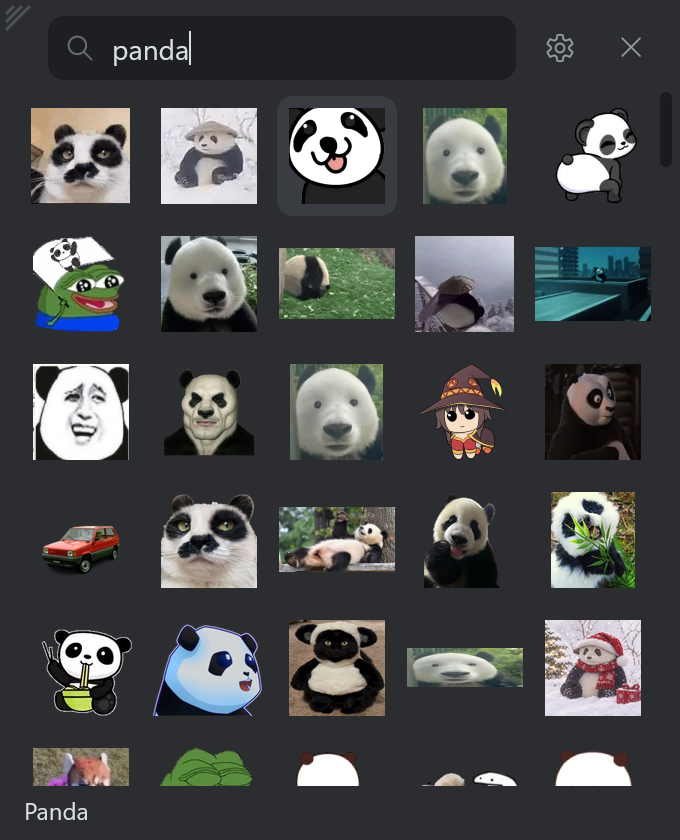
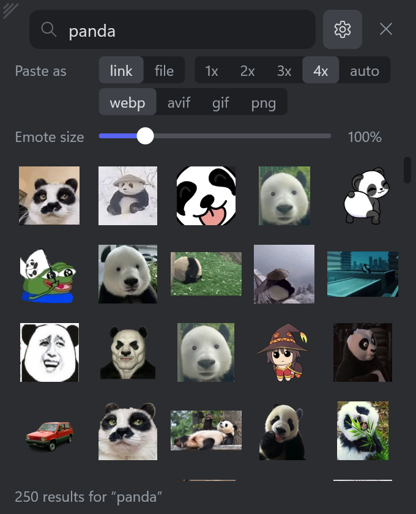

# 7TV Emote Picker

A small panel docked to the bottom-right of Discord's window, just above the message box. It only shows while Discord (or the picker) is in front. Type to search [7TV](https://7tv.app) emotes and click one to paste it into Discord: either its link or, with the gear button set to *file*, the emote file itself, which Discord uploads with your message. Whatever you had copied before goes back on the clipboard right after. The X shrinks the panel to a small button in the same corner of Discord; click it to open the panel again, or right-click it (or the X) to quit.

<p>
  
  
</p>

A search for *panda*, with the mouse on an emote (its name shows at the bottom), and the gear button's settings: link or file, the size and format to paste, and how big the emotes show.

Discord shows an uploaded picture at its size in pixels, so 7TV's sizes come out smaller (1x, 32px) or bigger (2x, 64px) than Discord's own emotes (48px). With the size set to *auto*, file mode resizes gif and png files to 48px tall to match (`DISCORD_EMOTE_SIZE` in `src/config.h`).

Windows only: C++20 on Win32, Direct2D, DirectWrite, WIC and WinHTTP. The previews are 7TV's WebP files, read with Google's libwebp decoder, included in `third_party/libwebp` (BSD license) and built by `build.cmd`.

## Build

Needs Visual Studio or the free Build Tools for Visual Studio, with the C++ workload.

```
build.cmd         builds "7TV Emote Picker.exe"; starting it replaces a copy that's running
build.cmd test    also builds build\render_test.exe, which draws the picker offscreen into PNGs
```

Things you might want to change are in `src/config.h`. How fast a search shows its emotes, and what was measured to make it faster: [docs/search-speed.md](docs/search-speed.md). `emote_picker.pyw` is the original Python version, kept for reference.

## Versions

Every change is a Git commit. Releases are tagged `vX.Y` to match the file version in `src/app.rc`.

Build output, `settings.json` (your panel size and gear-button choices, saved next to the exe) and `picker.log` (written only when `PICKER_LOG=1` is set) stay on your PC and are not tracked; see `.gitignore`.
